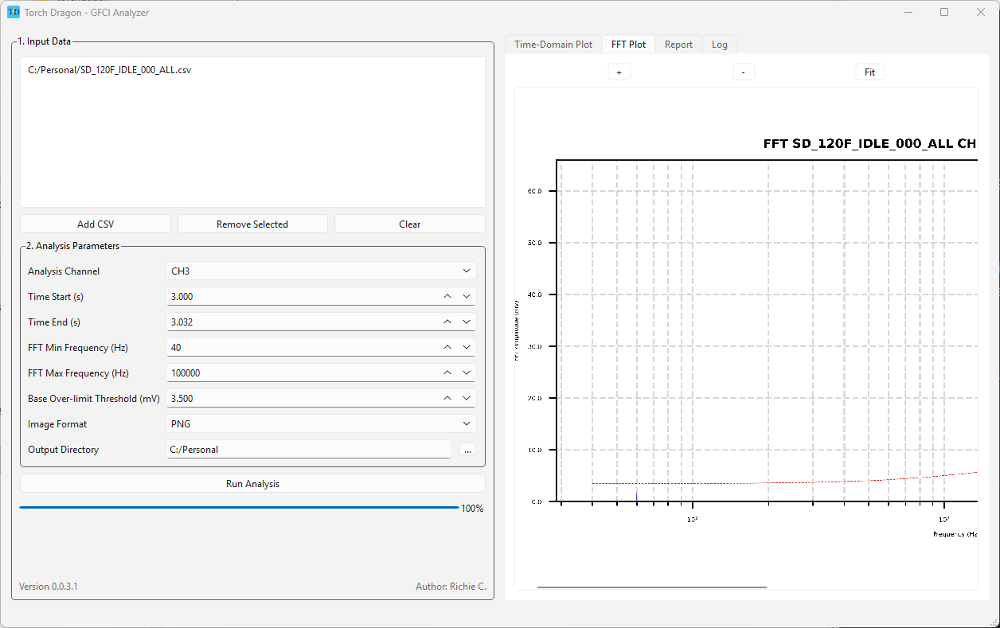
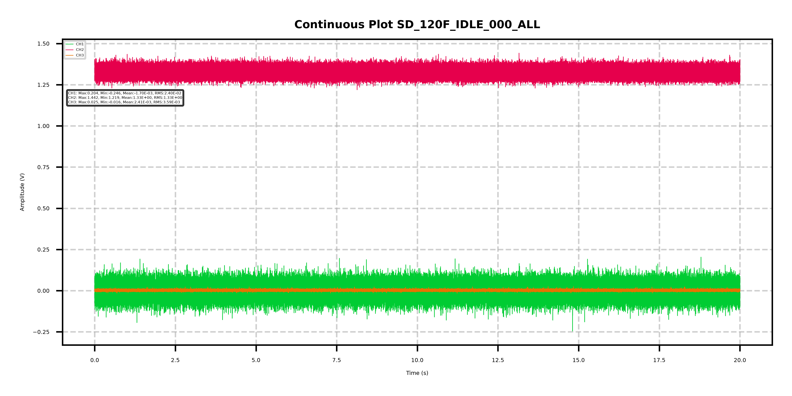
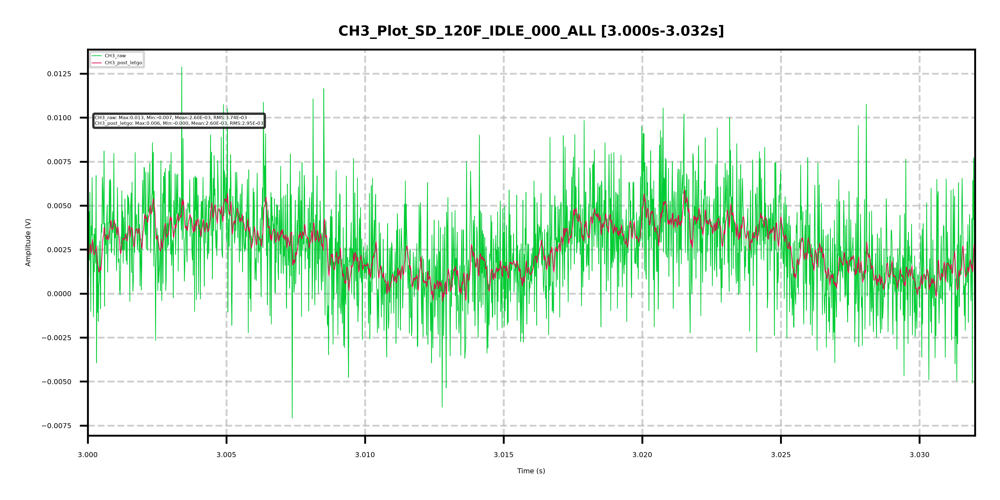
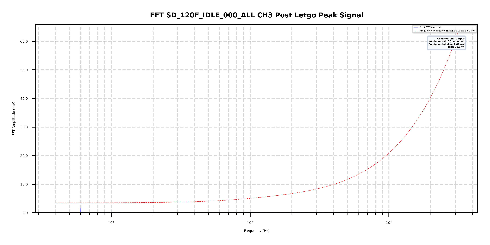
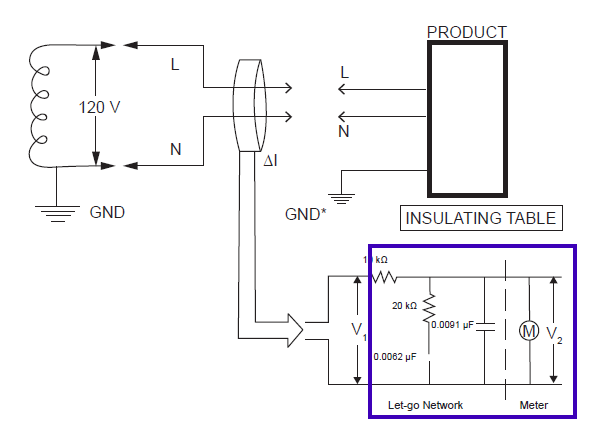
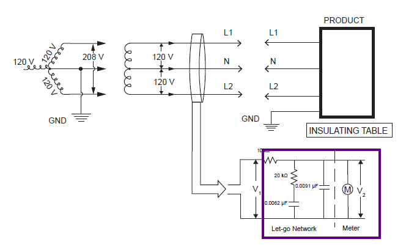
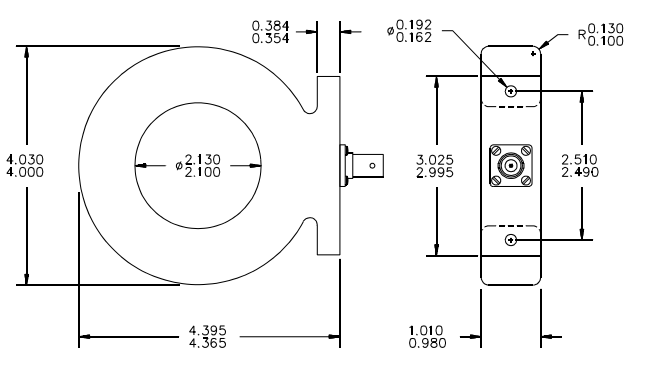

# Torch Dragon - GFCI Interoperability Test Data Analysis Tool

## About Torch Dragon

  

**<mark>TorchDragon</mark>** is a **Windows** and **MAC OS** GUI tool that analyzes GFCI Interoperability V1 raw results from oscilloscope log data (CSV).

-------------------------------

## The main functions

### 1. The time domain data

* Plot the raw data(V1) with multiple channels as a time-current diagram, labeled with the 'MIN/MEAM/MAX/RMS' values in a picture.
* Translate the raw data from the oscilloscope into time-domain data, and save as 'CSV'

### 2. Let-go network simulation

* 'TorchDragon' software will simulate the IIU result, which is the output voltage(V2) with the selected channel software.
* Given an option for the user to export specific time window data: Time/V1/V2, and save as 'CSV'.

### 3. FFT simulation and IIU

* Plot the FFT diagram for IIU(V2). With input IIU passing criteria('Limit in IIU') shown as a red dotted line. 'TorchDragon' will label the over-limit current(RMS) and frequency.
* Save Frequency/V2/Limit as '*.csv'

### 4. Test Report

* Generate test report summary, and list out time-domain RMS data for each waveform, if over the pass criteria software also list out chart for failed frequency and V2 result.

### Demo Result

**Fig 1.Raw Data Plot**

**Fig 2. Specific Time Window Plot**

**Fig 3. FFT Analysis**

---

## Oscilloscope CSV Data Compatibility

Current software supports <mark>Tektronix MSO44 and MSO54</mark> CSV exports, including single-channel and multiple-channel log data.

# About GFCI Interoperability Test

## Test Configuration

Per Section 6.3 of UL101 Sixth Edition, 2017, 2 different single-phase power system configurations are shown below.

Log the V1 data only. TorchDragon will simulate the V2 RMS and FFT analysis.

* 1. Measurement Instrument for GFCI Interoperability Test Intended for Connection to 120 V Circuits

* 2. Measurement Instrument for GFCI Interoperability Test Intended for Connection to 208/230 V Circuits

---

## Current Transformer

**Supplier Name**: Pearson

**P/N**: 8122

[Pearson 8122 Spec](https://pearsonelectronics.com/pdf/8122.pdf)

---

### Key Parameters

| Sensitivity           | 1 Volt/Ampere ±1%              |
| :-------------------- | :------------------------------ |
| Output resistance     | 1000 Ohms                       |
| Maximum peak current  | 500 A                           |
| Maximum RMS current   | 40 A                            |
| Droop rate            | 4 %/ms                          |
| Usable rise time      | 400 ns                          |
| Current time product  | 0.1 Ampere-second max.*         |
| Low frequency         | 3dB cut-off 6 Hz (approximate)  |
| High frequency        | 3dB cut-off 1 MHz (approximate) |
| I/f figure            | 0.6 peak Amperes/Hz             |
| Output connector      | BNC (UG-290A/U)                 |
| Operating temperature | 0 to 65 C                       |
| Weight                | 22 ounces                       |

---

### Oscilloscope Setting

The sampling interval should be <mark> >= 1 M/s</mark>. If the sampling frequency is low, distortion will occur in the Fast Fourier Transform data, thereby compromising the accuracy of the test.

---

### Limitation

The Let-go circuit simulation function still have some limitations. When the frequency is <mark>above 50 KHz</mark>, the tolerance will increase up to 10%.

| Frequency (Hz) | V1/V2 TorchDragon | V1/V2 (UL101) | Tolerance(%) |
| :------------: | :---------------: | :-----------: | :----------: |
|       20       |         1         |       1       |    0.00%    |
|       50       |      1.00191      |       1       |    0.19%    |
|       60       |     1.002748     |       1       |    0.27%    |
|      100      |     1.007591     |     1.01     |    -0.24%    |
|      200      |     1.029614     |     1.03     |    -0.04%    |
|      500      |     1.158935     |     1.16     |    -0.09%    |
|      1000      |     1.440952     |     1.44     |    0.07%    |
|      2000      |     1.926994     |     1.93     |    -0.16%    |
|      5000      |     3.323887     |     3.32     |    0.12%    |
|     10000     |     5.988785     |     5.97     |    0.31%    |
|     20000     |     11.719685     |     11.56     |    1.38%    |
|     50000     |     31.314958     |     28.64     |    9.34%    |
|     100000     |     89.637303     |     57.2     |    56.71%    |
|     200000     |        ∞        |    114.37    |      ∞      |
|     500000     |        ∞        |    285.89    |      ∞      |
|    1000000    |        ∞        |    571.77    |      ∞      |
